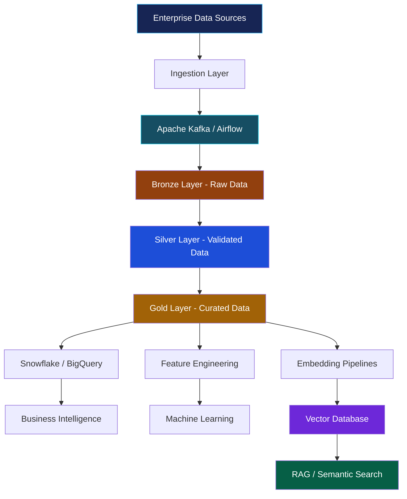
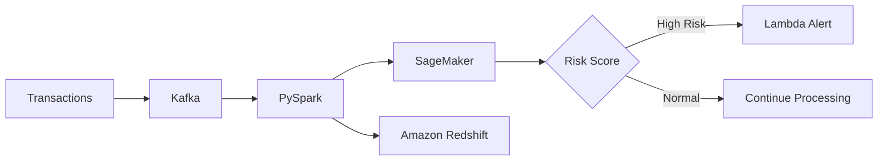
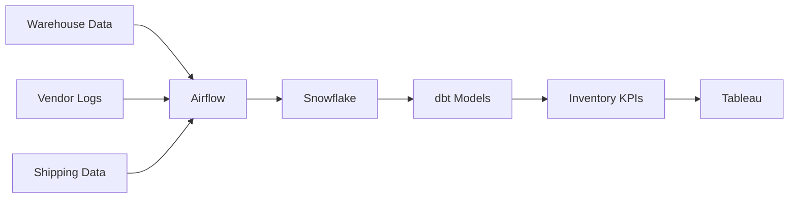

<div align="center">


<br/>

<a href="https://www.linkedin.com/in/bhavya-pidikiti/">
  
</a>
<a href="mailto:bhavya@myworkgmail.com">
  
</a>


<br/><br/>


### ☁️ Cloud Data Engineering • ⚡ Distributed Processing • 🧠 AI Infrastructure

*Building reliable data platforms that turn complex information into intelligent decisions.*

</div>

---

## 👩‍💻 About Me

```python
class AIDataEngineer:
    def __init__(self):
        self.name = "Bhavya Pidikiti"
        self.role = "AI Data Engineer"
        self.experience = "5+ Years"
        self.location = "USA"

        self.languages = ["Python", "SQL", "T-SQL"]

        self.cloud = {
            "GCP": ["BigQuery", "GCS", "Cloud Composer"],
            "Azure": ["Synapse", "Azure Functions", "Azure DevOps"],
            "AWS": ["S3", "Glue", "Redshift", "EMR"]
        }

        self.data_engineering = [
            "Apache Spark", "PySpark", "Databricks",
            "Snowflake", "Apache Airflow", "dbt",
            "Kafka", "Delta Lake"
        ]

        self.ai_infrastructure = [
            "RAG", "Vector Embeddings",
            "Semantic Search", "LangChain",
            "LlamaIndex", "Vector Databases"
        ]

    def mission(self):
        return (
            "Build scalable, reliable, AI-ready "
            "enterprise data platforms."
        )
```

I am an **AI Data Engineer with 5+ years of experience** designing cloud data platforms, distributed processing systems, enterprise warehouses, and production-oriented AI infrastructure.

My expertise spans **GCP, Azure, AWS, Python, SQL, Apache Spark, PySpark, Databricks, Snowflake, BigQuery, and Apache Airflow**.

I specialize in:

- Designing high-throughput ETL/ELT pipelines
- Building medallion architecture data lakes
- Developing batch and streaming data workflows
- Implementing Retrieval-Augmented Generation (RAG) data infrastructure
- Optimizing distributed processing and SQL performance
- Automating data validation, governance, and CI/CD
- Delivering analytics-ready datasets for enterprise decision-making

---

## 📊 Engineering Impact

<div align="center">

| ⚡ Performance | 📡 Streaming | 🛡️ Reliability | 🧠 AI Retrieval |
|:---:|:---:|:---:|:---:|
| **3× Faster** | **18% Lower** | **32% Fewer** | **12% Better** |
| SQL Execution | Processing Latency | Support Tickets | Retrieval Precision |

<br/>

| Metric | Achievement |
|---|---|
| 🚀 Data Processing | Reduced weekly pipeline processing time by 15% |
| 🔎 AI Search | Supported retrieval portals handling 5K queries |
| 🧹 Data Quality | Saved 8 manual validation hours weekly |
| 📊 Data Reliability | Improved dataset reliability by 25% |
| 🏗️ Data Warehousing | Reduced retrieval latency by 18% |
| 💰 Inventory Optimization | Reduced excess inventory holding costs by 18% |

</div>

---

## 🏗️ Cloud Data Engineering Architecture

<div align="center">



*From enterprise data ingestion to analytics-ready datasets and AI-powered retrieval.*

</div>

---

## 🛠️ Technical Arsenal

### 🐍 Programming & Big Data

<p>

</p>


### ☁️ Cloud Platforms

<p>

</p>


### 🔄 Data Engineering & Orchestration


### 🧠 AI Data Infrastructure & LLMOps


### ⚙️ DevOps, Data Quality & CI/CD


---

## 💼 Professional Experience

### 🎓 AI Data Engineer | Penn State University

**USA | May 2025 – Present**

- Optimized PySpark pipelines processing student and research text logs, automating Delta Lake ETL stages and feeding embeddings into RAG frameworks, reducing weekly processing time by **15%**.
- Engineered distributed SQL and ETL pipelines for campus feedback retrieval, improving retrieval precision by **12%** and supporting search portals handling **5K queries**.
- Built Python and Spark workflows transforming interaction logs into medallion architecture datasets for semantic search and academic advisory applications.
- Migrated legacy relational databases into a centralized PostgreSQL warehouse using Apache Airflow, supporting a **10-person research analytics team**.
- Implemented multi-layer validation across campus surveys and audio transcripts, saving **8 manual hours weekly**.
- Collaborated with machine learning researchers on data contracts and GitLab CI/CD routines for reliable AI data workflows.

**Core Technologies:** Python, PySpark, SQL, Delta Lake, Apache Airflow, PostgreSQL, RAG, Vector Embeddings, GitLab CI/CD.

---

### 🛒 Data/AI Engineer | The Kroger Co.

**USA | Aug 2024 – Apr 2025**

- Built Databricks and Apache Spark ETL workflows processing inventory data for 84.51° analytics models and standardized feature tables.
- Developed Kafka streams capturing Point of Sale transactions for the Kroger Plus loyalty program, reducing processing latency by **18%**.
- Migrated Hadoop data into Google Cloud Storage and BigQuery, orchestrating workloads with Cloud Composer.
- Engineered reusable e-commerce dimensional models using dbt, SQL macros, and standardized transformation logic.
- Integrated schema validation into GitLab CI/CD pipelines, reducing monthly data support tickets by **32%**.
- Delivered curated Snowflake views supporting merchandising dashboards and predictive feature stores.

**Core Technologies:** Apache Spark, Databricks, Kafka, GCP, BigQuery, Cloud Composer, Snowflake, dbt, GitLab CI/CD.

---

### ☁️ Data Engineer | Microsoft

**India | Jun 2021 – Aug 2023**

- Engineered enterprise ingestion pipelines integrating relational and NoSQL systems into centralized cloud data lakes.
- Optimized Azure Synapse and distributed Spark processing workloads, accelerating SQL execution by **3×**.
- Developed Python preprocessing and validation workflows improving dataset reliability by **25%**.
- Designed dimensional models and star-schema warehouses, reducing retrieval latency by **18%**.
- Built Power BI dashboards enabling **20+ stakeholders** to monitor operational KPIs.
- Automated serverless processing and deployment workflows through Azure DevOps CI/CD.

**Core Technologies:** Python, SQL, Azure Synapse, Apache Spark, Power BI, Azure DevOps, Data Warehousing.

---

### 📊 Data Analyst Intern | Microsoft

**India | Jun 2020 – May 2021**

- Prepared and optimized SQL datasets in Azure Databricks for analytics deliverables across **3 active accounts**.
- Validated enterprise ETL migration tasks, identifying **12 recurring mapping discrepancies** and improving data accuracy by **14%**.
- Collaborated on **6 Power BI dashboards** and maintained technical documentation supporting enterprise reporting.

**Core Technologies:** SQL, Azure Databricks, Power BI, ETL Validation, Data Modeling.

---

## 🚀 Featured Projects

### 🛡️ Real-Time Fraud Detection & Transaction Risk Scoring

**Python | Kafka | PySpark | AWS Lambda | Redshift | SageMaker**

Developed a streaming fraud-detection architecture integrating transaction feature engineering, anomaly detection, and automated risk alerts.

**Key capabilities:**
- Transaction velocity analysis
- Geolocation mismatch detection
- Spending pattern deviation analysis
- SageMaker-hosted anomaly detection
- Automated AWS Lambda risk alerts

**Impact:** Estimated **25% reduction in fraudulent exposure** through automated transaction risk monitoring.



---

### 📦 Multi-Vendor Retail Supply Chain & Inventory Optimization

**Python | Snowflake | dbt | Apache Airflow | Tableau**

Designed an automated inventory synchronization platform integrating multi-warehouse stock levels, vendor fulfillment logs, and shipping information.

**Key capabilities:**
- Multi-source inventory integration
- Snowflake cloud warehousing
- Automated Airflow orchestration
- Modular dbt transformation models
- Dynamic safety stock calculations
- Tableau-based inventory analytics

**Impact:** Contributed to an **18% reduction in excess inventory holding costs**.



---

## 🎓 Education

<table>
<tr>
<td width="50%" valign="top">

### 🎓 University of Cincinnati

**Master of Science in Information Systems**

📍 Cincinnati, Ohio

📅 Aug 2023 – May 2025

</td>
<td width="50%" valign="top">

### 🎓 GITAM University

**Bachelor's in Information Technology**

📍 Visakhapatnam, Andhra Pradesh

📅 Jul 2017 – Jul 2021

</td>
</tr>
</table>

---

## 🏆 Certifications & Training

<div align="center">


<br/><br/>


<br/><br/>


</div>

---

## 🎯 Engineering Philosophy

```yaml
engineering_principles:
  scalability:
    - Distributed processing
    - Modular data architecture
    - Cloud-native infrastructure

  reliability:
    - Automated validation
    - Schema enforcement
    - Data contracts
    - CI/CD integration

  performance:
    - Query optimization
    - Partitioning strategies
    - Efficient orchestration

  ai_readiness:
    - Clean and curated datasets
    - Vector embedding pipelines
    - Semantic retrieval
    - RAG integration

  business_value:
    - Analytics-ready datasets
    - Reliable decision support
    - Measurable operational impact
```

---

## 📈 GitHub Analytics

<!-- Replace YOUR_GITHUB_USERNAME with your actual GitHub username. -->

<div align="center">


<br/>


</div>

---

## 🤝 Let's Connect

<div align="center">

### Building Scalable Data Platforms. Powering Intelligent Applications.


<a href="https://www.linkedin.com/in/bhavya-pidikiti/">
  
</a>

<a href="mailto:bhavya@myworkgmail.com">
  
</a>

<br/><br/>

**"Reliable data engineering is the foundation of intelligent systems."**

⭐ **From Raw Data → Reliable Pipelines → AI-Ready Intelligence**

</div>
